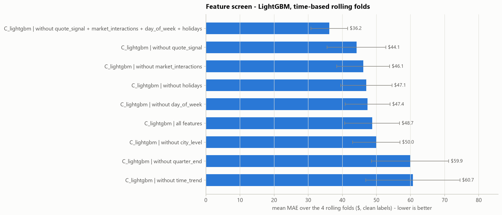
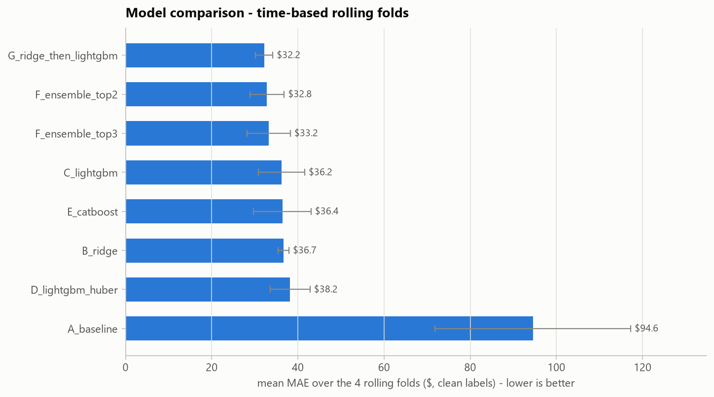
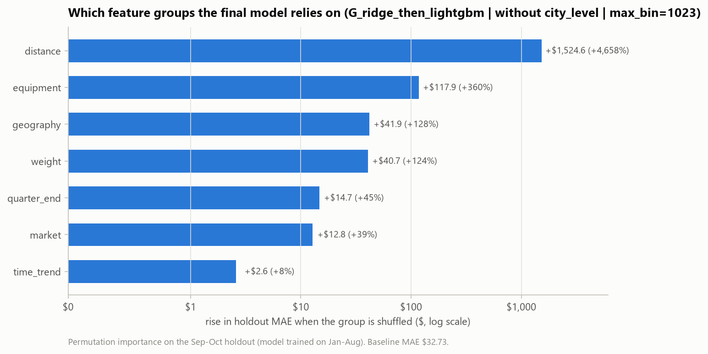
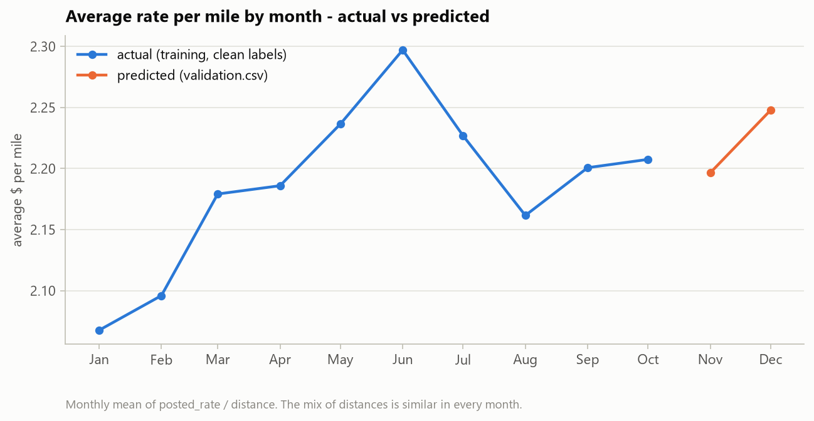
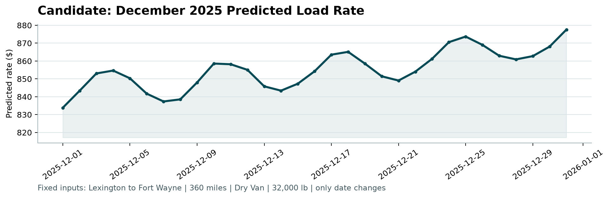
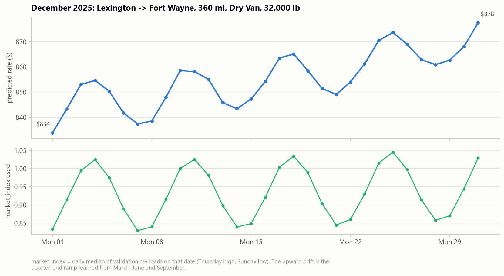

# Freight Rate Prediction - Approach, Validation and Results

*Spotter - Machine Learning Engineer assessment. All numbers in this report are produced by
`python run_pipeline.py` (full run) and can be found in `outputs/` and `reports/figures/`.*

## Summary

* **Task.** Predict `posted_rate` for 12,000 truck loads in Nov-Dec 2025 from 48,000 labelled loads
  in Jan-Oct 2025. Every load to predict lies *after* every labelled load, so this is a forecast.
* **Split and validation.** Time-based only: 4 rolling monthly folds (train on everything before a
  month, test on that month) choose every setting and the model. A Sep-Oct two-month-ahead check and
  a random split are reported for comparison (section 4).
* **Data quality.** 677 corrupted prices (1.41%) were removed from training and scoring; sign-flipped,
  missing and capped weights and missing `market_index` values were fixed; suspicious distances were
  checked and turned out to be genuine (section 3).
* **Final model.** Ridge regression on log(price), followed by LightGBM trained on Ridge's errors
  (model G). The linear part carries the 2025 price trend into Nov-Dec; the trees add the non-linear
  effects of distance, weight and location (section 7).
* **Result.** An average error of **$31.86 per load (1.36%)** over the rolling folds - 66% lower than a
  simple baseline and 12% lower than plain LightGBM - and $32.73 (1.39%) on the two-month-ahead check.
* **December chart.** The fixed Lexington -> Fort Wayne load rises from $834 to $878 through December:
  a weekly market cycle plus the price ramp that every quarter-end month showed in training (section 8).

---

## 1. The task and the data

| File | Rows | Period | Purpose |
|---|---|---|---|
| `data/train-test.csv` | 48,000 | 2025-01-01 to 2025-10-31 | labelled development data (`posted_rate`) |
| `data/validation.csv` | 12,000 | 2025-11-01 to 2025-12-31 | loads to predict (labels held by Spotter) |
| `data/december-chart-inputs.csv` | 31 | every day of Dec 2025 | one fixed load; only the date changes |

The validation loads are **in the future** relative to all labelled data. That one fact drives
the whole validation design: the model must be judged on how well it forecasts months it has
never seen, not on how well it interpolates between known loads.

Each load has: pickup / delivery city and coordinates, distance, equipment type (Dry Van, Reefer,
Flatbed), weight, date, `market_index`, `quote_signal` and (training only) `posted_rate`.

## 2. Key findings from exploring the data

1. **Distance dominates price.** Price grows a little slower than distance (roughly
   distance^0.87): short trips cost more per mile (fixed costs). Reefer loads cost ~12% more and
   flatbeds ~8% more than dry vans, at every distance.
2. **Heavier loads cost more** - flat below ~15k lb, rising between 20k and 40k lb, flat again
   above ~40k lb (about a 7-8% spread overall).
3. **`market_index` is a daily market reading with a strong weekly cycle** (Thursday high, Sunday
   low; spread within a day 0.025 vs 0.165 between days). Prices follow it only weakly: an
   elasticity of **0.14** (a 10% higher index means ~1.4% higher price). Its weekly cycle fully
   explains the day-of-week pattern in prices.
4. **A calendar effect that `market_index` does not explain** (figure below). After removing
   distance, equipment and market effects, prices
   * ramp up by roughly 4% through **every quarter-end month** (March, June, September) and drop
     back when the next quarter starts, and
   * drift upwards over the year: October sits ~5.6% above January-February.

   December is also a quarter-end month, so this matters directly for the December chart.

   

5. **`quote_signal` changes "regime" from month to month** (its distribution shifts and skews),
   and **November-December look exactly like August** (1% / 50% / 99% quantiles 1.54 / 2.05 / 2.56
   vs 1.53 / 2.05 / 2.55) - the one training month where `quote_signal` has **no** relationship
   with price (correlation -0.008).

   

6. **City price levels vary smoothly across the map** (-3.4% for Syracuse to +2.8% for Oklahoma
   City), and a city's effect is the same whether it is the pickup or the delivery end
   (correlation 0.99). **Eight validation cities never appear in training** (Allentown, Charlotte,
   Chicago, Jackson, Knoxville, Laredo, Norfolk, San Diego), touching 1,447 validation loads (12.1%).
   Because city levels follow location, a model that knows each city's coordinates can price these
   cities too - the map below shows the level estimated from each one's 5 nearest training cities.

   

## 3. Data-quality issues and how they were fixed

Every fix is a separate function in `src/data_cleaning.py` and logs how many rows it touched.
Anything learned from data (medians, lane distances, the reference price) is learned from the
training rows only and re-used for validation / December rows.

| Issue | Evidence | Fix | Train | Validation |
|---|---|---|---:|---:|
| Negative weights | magnitudes look like normal weights (median ~31.8k lb) | `abs()` - sign-flip error | 292 | 145 |
| Weight capped at 47,500 lb | a spike of loads at exactly 47,500 | keep value, add flag `weight_was_capped` (the weight effect is flat up there) | 1,204 | 301 |
| Missing weight | NaN | training median of the same equipment type + flag `weight_was_missing` | 300 | 165 |
| Weight floor at 5,000 lb | a spike at exactly 5,000 | none needed (weight effect is flat below ~15k lb) - documented | 32 | 7 |
| Missing `market_index` | NaN | median of the **same date in the same file** (it is a daily value) + flag | 374 | 249 |
| Corrupted `posted_rate` | two clusters at 0.15-0.5x and 2-6x the expected price | flagged and **removed from training** (and from scoring - see section 4) | 677 (1.41%) | - |
| "Too long" distances | 12 loads are >3x the straight-line distance | **not corrupted** - all are 70-mile-floor loads between cities whose synthetic coordinates almost coincide (New Orleans-Shreveport); checked against each lane's median distance instead: 0.76-1.28x, so nothing changed | 0 changed | 0 changed |

**Detecting corrupted prices.** A deliberately simple *reference price* (median $/mile per
equipment type and distance band, scaled by `market_index` with the learned elasticity) gives an
expected price for every load. Every clean load lies between 0.84x and 1.21x of it; the corrupted
ones lie below 0.5x or above 2x, with **nothing in between**. The cut-offs 0.6x and 1.8x sit in
that empty gap, so the result does not depend on their exact values.


Two alternatives were compared (section 6): dropping the flagged rows vs keeping them and
training with a robust Huber loss. Dropping was clearly better.

### Assumptions the data did not confirm

Every suspected issue was checked in the data before it was "fixed". Some first impressions did not hold:

* Distances that look 5-10x too long compared with the straight line are **not** corrupted (see the
  table above) - no distance was changed.
* The weight cap affects 1,204 training loads, including 13 that were also sign-flipped (-47,500), so
  the sign is fixed before the cap is detected.
* There is also a weight floor at 5,000 lb.
* `market_index` is **not** the only seasonal driver: the quarter-end ramp and the yearly drift
  remain after accounting for it, so seasonality cannot "come through market_index" alone.
* `market_index` matters less than expected (elasticity 0.14); its weekly cycle is what
  explains the day-of-week pattern, and no holiday effect is visible in the training data.
* `quote_signal` is regime-dependent and uninformative in months like Nov-Dec.

## 4. How the data was split and validated

The brief leaves the split to the candidate. Since every load to predict lies after every labelled
load, the split imitates that situation: **train on the past, test on a later period.** Nothing is
ever tested on a date that lies inside its training period.

### Rolling monthly folds - used for every decision

| Fold | Training period | Training loads | Test period | Test loads |
|---|---|---:|---|---:|
| Jul | Jan 1 - Jun 30 | 28,806 | Jul 1 - Jul 31 | 4,912 |
| Aug | Jan 1 - Jul 31 | 33,718 | Aug 1 - Aug 31 | 4,759 |
| Sep | Jan 1 - Aug 31 | 38,477 | Sep 1 - Sep 30 | 4,670 |
| Oct | Jan 1 - Sep 30 | 43,147 | Oct 1 - Oct 31 | 4,853 |

Every candidate is trained four times, once per fold, and scored on the month that follows its
training data. Its score is the **mean MAE over the four months**. All choices - which feature groups
to keep, which model, the target transformation, the number of trees and the hyper-parameters - use
this score. The rule: lowest mean MAE; results within 0.2% of each other count as a tie, broken by
the lower MAPE.

### Two-month-ahead check - Sep-Oct

Train on Jan-Aug (38,477 loads), test on Sep-Oct (9,523 loads). Nov-Dec lie one to two months after
the end of training, so this shows how the error behaves further ahead. Sep and Oct are also test
months of the rolling folds, so this is a consistency check rather than a fully untouched test set.

### Why not a random split

A random 80/20 split gives the final model an MAE of **$30.28**, against **$32.73** on the
two-month-ahead check - about 8% too optimistic. Random test loads share dates, and therefore the
daily price level, with training loads, which can never happen when forecasting Nov-Dec. The random
split is computed for comparison only and never used for a decision.

### Rules that prevent leakage

* **Every split is cleaned and featurised from its own training rows.** Median weights, typical lane
  distances, the reference price, the KMeans regions and the city price levels are learned from the
  training part only and then applied, unchanged, to the test part.
* **Target-encoded city levels** (tested, not used by the final model) only use loads from earlier
  dates for training rows, so no row ever sees its own price or the future.
* **Missing `market_index`** values are filled from other loads of the same date in the same file. This
  uses no prices, so it cannot leak the answer.
* **The number of trees** is chosen without peeking at a single fold: each boosting model grows 3,000
  trees once per fold and is scored every 250 trees; the checkpoint with the best *mean* error over
  the folds is used for every fold, and the final model scales it to its larger training set.

### Scoring on clean labels

The 1.4% of prices flagged as corrupted are left out when errors are measured, because no model can
predict a price recorded at 0.2x or 4x its real value. Both versions are kept in
`outputs/cv_fold_details.csv`: on all rows, the final model's two-month-ahead error is $88.88 (3.92%)
instead of $32.73 (1.39%), and almost the whole difference comes from those 1.4% of loads.

### Cities that never appear in training

1,447 validation loads (12.1%) touch one of 8 cities that never appear in training. To measure the
effect, 8 random training cities were removed from the Jan-Aug training data. On the 2,477 Sep-Oct
loads that touch them, the error rose from **$33.62 (1.36%)** when the cities were seen to
**$38.60 (1.57%)** when they were not; all other loads stayed at $32.55. Coordinates recover most, but
not all, of a city's price level.

## 5. Features

Price is mostly distance x rate per mile, adjusted by equipment, weight, location and date. The 37
engineered features are organised in 12 groups so that a whole idea can be switched off at once:

| Group | Features | In final model? | Evidence |
|---|---|---|---|
| distance | distance, log distance, straight-line miles, road / straight-line ratio | yes | the main driver of price |
| geography | pickup and delivery coordinates, direction of travel, midpoint, 8 KMeans regions | yes | also prices the 8 unseen cities |
| equipment | reefer, flatbed (dry van is the baseline) | yes | ~12% / ~8% above dry van |
| weight | weight, missing flag, capped flag, weight x distance | yes | ~7-8% spread |
| market | `market_index` | yes | elasticity 0.14 |
| quarter_end | quarter-end month flag, progress through the month | yes | removing it: $48.75 -> $59.87 |
| time_trend | months since January 2025 | yes | removing it: $48.75 -> $60.70 |
| city_level | target-encoded city and lane price levels | no | model G: $31.96 without vs $32.17 with |
| quote_signal | `quote_signal` | no | removing it: $48.75 -> $44.15 |
| market_interactions | market x distance, market x equipment | no | removing it: $48.75 -> $46.11 |
| day_of_week | day of week, weekend flag | no | removing it: $48.75 -> $47.40 |
| holidays | holiday week, days to nearest holiday | no | removing it: $48.75 -> $47.05 |

The feature screen started from LightGBM with all 12 groups (mean MAE $48.75) and removed one optional
group at a time. Removing the four groups whose removal helped, all together, brought the error down
to **$36.20**:



**Why the calendar features look like this.** Training covers Jan-Oct only, so a month-of-year
feature could never learn anything about November or December. Instead, the model uses features
whose values do occur in training: the *progress through a quarter-end month* (December is one, like
March, June and September) and a *months-since-start* trend.

**Why `quote_signal` was dropped.** Its distribution changes from month to month, and in August - the
month whose distribution Nov-Dec match - it has no relationship with price. Adding it to the final
model type raised the August error from $30.85 to **$39.05**, exactly the failure expected for Nov-Dec.

## 6. Models compared

All models predict log(price), so errors are relative (1% off is 1% off for a $300 load and for a
$5,000 load). Mean MAE over the four rolling folds, clean labels:

| Model | CV MAE | MAPE | Jul | Aug | Sep | Oct | Sep-Oct check |
|---|---:|---:|---:|---:|---:|---:|---:|
| A - reference-price baseline | $94.56 | 4.12% | 73.99 | 84.08 | 132.93 | 87.23 | $119.54 |
| B - Ridge regression | $36.65 | 1.57% | 35.75 | 35.16 | 38.30 | 37.38 | $37.75 |
| C - LightGBM | $36.20 | 1.57% | 33.35 | 31.91 | 34.12 | 45.41 | $44.61 |
| D - LightGBM, Huber loss, corrupted rows kept | $38.20 | 1.68% | 36.17 | 34.23 | 36.36 | 46.05 | $46.60 |
| E - CatBoost with raw city names | $36.40 | 1.57% | 32.74 | 30.95 | 34.15 | 47.73 | $44.25 |
| F - average of G + C | $32.83 | 1.41% | 31.94 | 29.60 | 30.25 | 39.55 | $37.02 |
| F - average of G + C + E | $33.21 | 1.42% | 31.32 | 29.18 | 30.47 | 41.85 | $38.66 |
| **G - Ridge, then LightGBM on Ridge's errors** | **$32.17** | **1.37%** | 32.55 | 30.85 | 30.02 | **35.25** | **$32.78** |



**What the comparison shows**

* **October is the hard month.** It starts a new quarter, and prices stepped up. Tree models (C, D, E)
  can only repeat the last price level they saw, so they missed October by $45-48 per load. Ridge
  extends the 2025 trend and missed by only $37, but is less precise in the other months.
* **Model G combines the two strengths.** Ridge learns the smooth, multiplicative structure and the
  trend; LightGBM then starts from Ridge's prediction and only learns the corrections (curved distance
  and weight effects, location details). Its trees are not given the trend feature, so the trend stays
  linear. G is the most accurate single model, and much steadier from month to month than the pure
  tree models (spread $2.00 vs $5.38 for LightGBM).
* **Averaging did not beat G.** Adding C or E to G helped in Jul-Sep but hurt in October, because the
  pure tree models pull the forecast back towards the old price level.
* **Removing the corrupted rows beat keeping them with a robust loss** (C $36.20 vs D $38.20).

### Fine-tuning the best model

| Variant of model G | CV MAE | MAPE | Aug | Oct |
|---|---:|---:|---:|---:|
| G, as in the comparison | $32.17 | 1.37% | 30.85 | 35.25 |
| without the city target encoding | $31.96 | 1.37% | 30.58 | 35.46 |
| with `quote_signal` added | $33.30 | 1.42% | 39.05 | 34.26 |
| target = $ per mile | $33.46 | 1.41% | 33.90 | 34.06 |
| target = raw dollars | $43.53 | 2.58% | 42.02 | 48.59 |
| without city encoding, `num_leaves` = 15 | $31.88 | 1.36% | 30.41 | 35.43 |
| without city encoding, `num_leaves` = 63 | $32.14 | 1.37% | 30.64 | 35.63 |
| without city encoding, `num_leaves` = 127 | $32.33 | 1.38% | 30.79 | 35.77 |
| **without city encoding, `max_bin` = 1023 (final)** | **$31.86** | **1.36%** | 30.41 | 35.44 |

* The **log target** clearly beats $ per mile and raw dollars.
* **The city target encoding is not needed.** City price levels follow location so closely that the
  coordinates already carry them, so the simpler model without it was kept.
* **Tuning changed the error by at most about 1%**, and the winning setting was only 0.3% better than
  the untuned model - within noise. `max_bin` = 1023 won by the selection rule; the default settings
  would be practically as good.

## 7. The final model

**Model G: Ridge regression followed by LightGBM trained on Ridge's errors, on log(price), without the
city target encoding, `max_bin` = 1023.** It was retrained on all 47,323 clean Jan-Oct loads.

1. **Ridge regression** (alpha = 1.0) uses all 26 features of the 7 kept groups (numbers scaled, regions
   one-hot encoded). It learns, for example, that prices rise about **0.6% per month** (the trend),
   about **4.6% through a quarter-end month**, and with an elasticity of **0.14** to `market_index`.
2. **LightGBM** (learning rate 0.05, 31 leaves, `max_bin` 1023) starts from Ridge's prediction and grows
   **2,330 trees** - the 1,750 chosen by cross-validation, scaled up for the larger training set - on
   the same features except the trend.
3. **Prediction** = exp(Ridge output + tree correction), in dollars.

**Why this model**

* It has the lowest mean error over the rolling folds, and it is accurate in every month - including
  October, where the pure tree models failed.
* It fits the forecasting problem: decision trees cannot extend a trend beyond the last month they
  saw, a linear model can, and G lets each part do what it is good at.
* It stays easy to explain: a linear price model plus learned corrections.

| Metric | Rolling folds (mean) | Two-month-ahead check |
|---|---:|---:|
| MAE | $31.86 | $32.73 |
| RMSE | $45.96 | $47.45 |
| MAPE | 1.36% | 1.39% |
| Median absolute % error | 1.16% | 1.18% |
| R2 | 0.9989 | 0.9988 |
| Bias (total predicted vs actual) | +0.04% | -0.44% |

By month: July $31.87, August $30.41, September $29.73, October $35.44.

**What the model relies on.** Shuffling one feature group at a time on the two-month-ahead check shows
how much each group matters. Distance dominates; equipment, location and weight follow; the
quarter-end ramp and the market index matter less but clearly help:



**The validation predictions.** Predicted prices range from $188 to $7,097 (median $2,076). The
average rate per mile is $2.197 in November and $2.248 in December, against $2.207 in October:
November stays close to the October level and December rises with the quarter-end ramp.



## 8. The December chart



*Chart produced by the provided `score.py` from `outputs/december_chart_predictions.csv`.*

The chart prices one fixed load - Lexington -> Fort Wayne, 360 miles, Dry Van, 32,000 lb - on every
day of December 2025. The file does not include every input the model needs, so the missing ones were
filled without touching the given values: city coordinates from the training data, and `market_index`
as the daily median of the `validation.csv` loads on the same date. The lane itself is well known:
it appears 32 times in training.

The prediction rises from **$834 on December 1 to $878 on December 31** (average $855). Two effects
shape the curve:

* **A weekly cycle** - `market_index` is high mid-week and low at weekends (lower panel below), which
  moves the price by roughly $15-20 within each week.
* **An upward drift** of about 2.7% from the first to the last week. December is a quarter-end month,
  and in March, June and September prices climbed about 4% through the month before resetting.



## 9. Limitations and next steps

* **One partial year of data.** Training has no November or December, so a genuine year-end season
  (holiday peak, Christmas week) cannot be learned. The forecast relies on the quarter-end pattern and
  the trend; holiday features were tested and did not help in the training months.
* **The trend is assumed to continue.** The linear part extends the 2025 trend by about 0.6% per month
  for two more months. A turn in the market would show up as a bias.
* **Corrupted labels.** If the Nov-Dec labels contain corruptions like the training data (about 1.4%),
  the measured error will be far higher than the clean-label error, for any model.
* **Unseen cities.** Loads touching the 8 new cities are expected to be about 15% less accurate.
* **Many decisions were made on the same four folds.** Small differences, such as the tuning results,
  are within noise and should not be over-read.
* **Next steps:** prediction intervals (quantile models), retraining every month as new loads arrive,
  monitoring for drift in `market_index` and `quote_signal`, and a second year of data to learn real
  seasonality.

## Appendix - reproduce every number

```bash
python -m pip install -r requirements.txt
python run_pipeline.py          # full run, ~45 minutes: every experiment in this report
python run_pipeline.py --fast   # ~10 minutes: rebuilds the same final model from the settings in src/config.py
```

All tables come from `outputs/model_comparison.csv`, `outputs/cv_fold_details.csv` and
`outputs/run_summary.json`; the full console output of the run is in `outputs/run_log.txt`.
