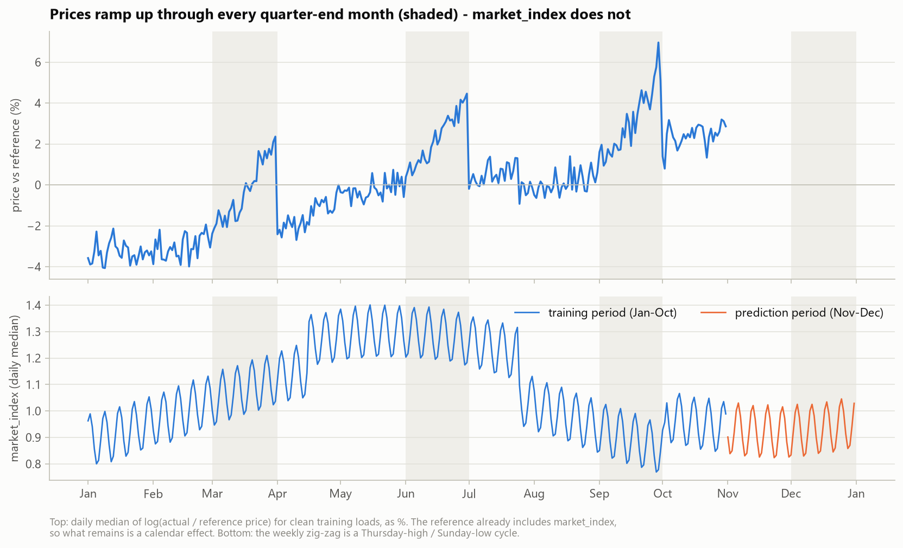
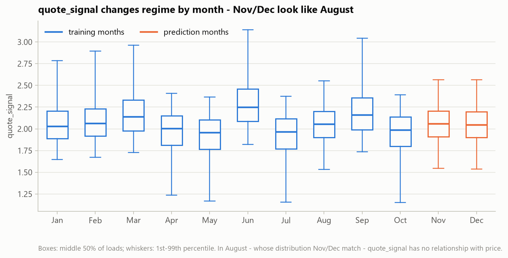
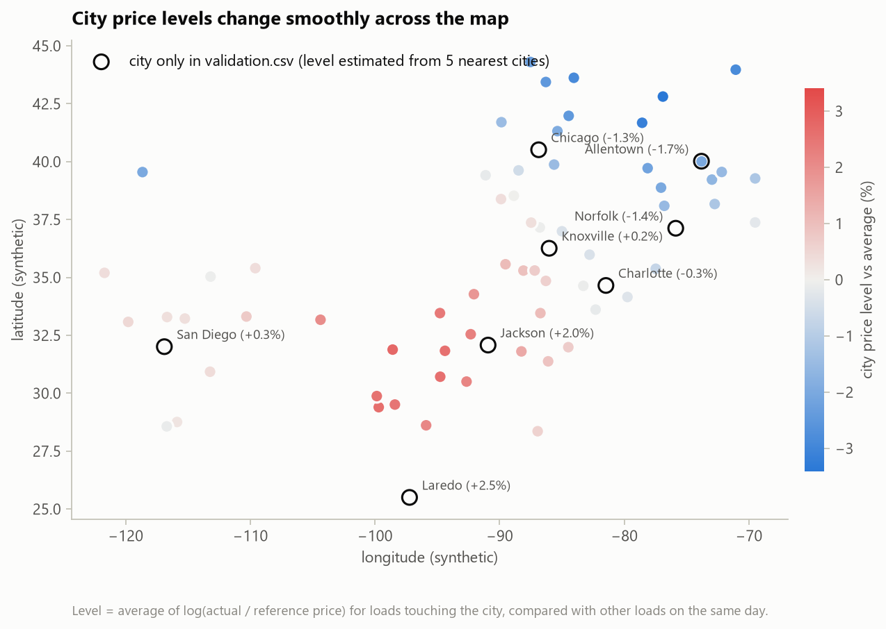
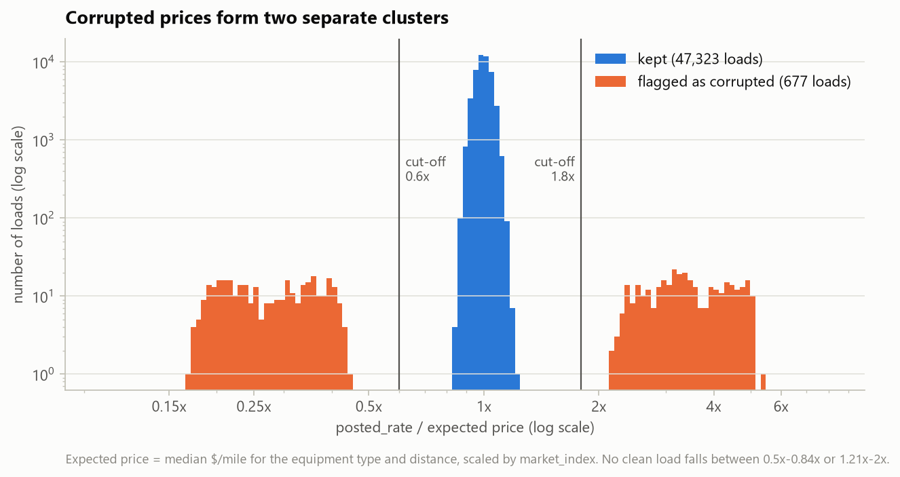

# Freight Rate Prediction - Approach, Validation and Results

*Spotter - Machine Learning Engineer assessment. All numbers in this report are produced by
`python run_pipeline.py` (full run) and can be found in `outputs/` and `reports/figures/`.*

SUMMARY_PLACEHOLDER

---

## 1. The task and the data

| File | Rows | Period | Purpose |
|---|---|---|---|
| `data/train-test.csv` | 48,000 | 2025-01-01 to 2025-10-31 | labelled development data (`posted_rate`) |
| `data/validation.csv` | 12,000 | 2025-11-01 to 2025-12-31 | loads to predict (labels held by Spotter) |
| `data/december-chart-inputs.csv` | 31 | every day of Dec 2025 | one fixed load; only the date changes |

The validation loads are **in the future** relative to all labelled data. That one fact drives
the whole validation design: the model must be judged on how well it forecasts months it has
never seen, not on how well it interpolates between known loads.

Each load has: pickup / delivery city and coordinates, distance, equipment type (Dry Van, Reefer,
Flatbed), weight, date, `market_index`, `quote_signal` and (training only) `posted_rate`.

## 2. Key findings from exploring the data

1. **Distance dominates price.** Price grows a little slower than distance (roughly
   distance^0.87): short trips cost more per mile (fixed costs). Reefer loads cost ~12% more and
   flatbeds ~8% more than dry vans, at every distance.
2. **Heavier loads cost more** - flat below ~15k lb, rising between 20k and 40k lb, flat again
   above ~40k lb (about a 7-8% spread overall).
3. **`market_index` is a daily market reading with a strong weekly cycle** (Thursday high, Sunday
   low; spread within a day 0.025 vs 0.165 between days). Prices follow it only weakly: an
   elasticity of **0.14** (a 10% higher index means ~1.4% higher price). Its weekly cycle fully
   explains the day-of-week pattern in prices.
4. **A calendar effect that `market_index` does not explain** (figure below). After removing
   distance, equipment and market effects, prices
   * ramp up by roughly 4% through **every quarter-end month** (March, June, September) and drop
     back when the next quarter starts, and
   * drift upwards over the year: October sits ~5.6% above January-February.

   December is also a quarter-end month, so this matters directly for the December chart.

   

5. **`quote_signal` changes "regime" from month to month** (its distribution shifts and skews),
   and **November-December look exactly like August** (1% / 50% / 99% quantiles 1.54 / 2.05 / 2.56
   vs 1.53 / 2.05 / 2.55) - the one training month where `quote_signal` has **no** relationship
   with price (correlation -0.008).

   

6. **City price levels vary smoothly across the map** (-3.4% for Syracuse to +2.8% for Oklahoma
   City), and a city's effect is the same whether it is the pickup or the delivery end
   (correlation 0.99). **Eight validation cities never appear in training** (Allentown, Charlotte,
   Chicago, Jackson, Knoxville, Laredo, Norfolk, San Diego); their level is estimated from their 5
   nearest training cities.

   

## 3. Data-quality issues and how they were fixed

Every fix is a separate function in `src/data_cleaning.py` and logs how many rows it touched.
Anything learned from data (medians, lane distances, the reference price) is learned from the
training rows only and re-used for validation / December rows.

| Issue | Evidence | Fix | Train | Validation |
|---|---|---|---:|---:|
| Negative weights | magnitudes look like normal weights (median ~31.8k lb) | `abs()` - sign-flip error | 292 | 145 |
| Weight capped at 47,500 lb | a spike of loads at exactly 47,500 | keep value, add flag `weight_was_capped` (the weight effect is flat up there) | 1,204 | 301 |
| Missing weight | NaN | training median of the same equipment type + flag `weight_was_missing` | 300 | 165 |
| Weight floor at 5,000 lb | a spike at exactly 5,000 | none needed (weight effect is flat below ~15k lb) - documented | 32 | 7 |
| Missing `market_index` | NaN | median of the **same date in the same file** (it is a daily value) + flag | 374 | 249 |
| Corrupted `posted_rate` | two clusters at 0.15-0.5x and 2-6x the expected price | flagged and **removed from training** (and from scoring - see section 4) | 677 (1.41%) | - |
| "Too long" distances | 12 loads are >3x the straight-line distance | **not corrupted** - all are 70-mile-floor loads between cities whose synthetic coordinates almost coincide (New Orleans-Shreveport); checked against each lane's median distance instead: 0.76-1.28x, so nothing changed | 0 changed | 0 changed |

**Detecting corrupted prices.** A deliberately simple *reference price* (median $/mile per
equipment type and distance band, scaled by `market_index` with the learned elasticity) gives an
expected price for every load. Every clean load lies between 0.84x and 1.21x of it; the corrupted
ones lie below 0.5x or above 2x, with **nothing in between**. The cut-offs 0.6x and 1.8x sit in
that empty gap, so the result does not depend on their exact values.

Two alternatives were compared (section 6): dropping the flagged rows vs keeping them and
training with a robust Huber loss. Dropping was clearly better.

### Where the data differed from the initial "known issues" list

* The ~20 "5-10x too long" distances are **not** corrupted (see table above) - no distance was changed.
* The weight cap affects 1,204 training loads, not 1,191: 13 capped values were also sign-flipped (-47,500).
* There is also a weight floor at 5,000 lb.
* `market_index` is **not** the only seasonal driver: the quarter-end ramp and the yearly drift
  remain after accounting for it, so seasonality cannot "come through market_index" alone.
* `market_index` matters less than expected (elasticity 0.14); its weekly cycle is what
  explains the day-of-week pattern, and no holiday effect is visible in the training data.
* `quote_signal` is regime-dependent and uninformative in months like Nov-Dec.

VALIDATION_PLACEHOLDER
